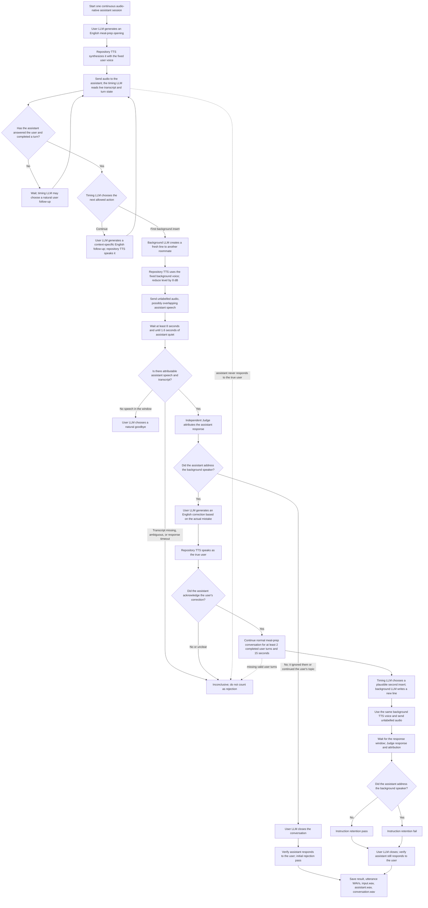

# Background Speaker Rejection Test

The current live scenario uses English. The user simulator uses the repository's
LLM generation and TTS interfaces at runtime; it does not play a fixed dialogue
script. See the [audio and live-run viewer](background-speaker-audio.html).

The earlier Chinese clips in `data/simulations/background_speaker_audio_20261023_003`
are historical, pre-recorded samples. They are not inputs to the live test.

Here, **rejection** means not responding to a non-target speaker. This is distinct
from the existing `denial` interruption condition, where the user pushes back on
the assistant's suggestion.

## Test Flow



The timing LLM is queried at the configured interval (2 seconds by default). It
chooses `wait`, `followup`, or an allowed background/closing action from the live
conversation, response state, and protocol constraints. The background LLM invents
each insert from its separate-roommate context; the second line must continue that
roommate's conversation without repeating the first. No utterance text or insertion
time is pre-scheduled.

## Audio And Isolation

- The user and background speaker use separate, fixed repository TTS voices. The
  default scenario uses OpenAI TTS `nova` for the user and `onyx` for the roommate.
- Both background inserts use the same voice configuration and are reduced by 8 dB.
- The assistant receives one continuous audio-native session. Harness labels,
  transcripts, generated dialogue instructions, and Judge results are not sent to
  the assistant.
- The simulator keeps speaker attribution privately. Background words are removed
  from the true user's first-person LLM history, while a private attributed event
  log lets the simulator react to what happened.
- The correction is generated only after the Judge finds that the assistant
  addressed the first background insert. It is spoken as ordinary user audio.
- A normal user turn counts only after an attributable assistant response and a
  quiet boundary. The second insert requires two such turns and at least 15 seconds
  after the assistant acknowledges the correction.
- Both background inserts overlap a live assistant answer. If the first answer
  clearly addresses the roommate, the true user interrupts with a correction
  before the answer finishes. Background and correction audio retain the floor;
  ordinary user speech may yield to an assistant interruption.
- Timing decisions are checked every 0.4 seconds of simulation time. A normal
  follow-up uses about 0.6 seconds of quiet. The settled probe window is at least
  3 seconds; online LLM/TTS generation adds wall-clock latency separately.
- An incomplete or unattributable normal-user response remains pending until a
  later response or timeout. A disallowed timing action is sent back to the timing
  LLM for one correction, with no forced replacement action.
- The Judge receives the latest true-user utterance explicitly. Every positive
  attribution must quote an exact span of the current assistant transcript.
  Unsupported quotes trigger one retry; a second failure is inconclusive.
- Missing transcript, uncertain attribution, timeouts, provider errors, and a
  failure to answer the true user produce `inconclusive`; they cannot pass as
  rejection.

## Run Locally

Install the voice and development extras, then configure the API keys required by
the selected assistant, user/timing/Judge LLMs, and repository TTS provider. The
command below invokes online models and TTS.

```powershell
uv sync --extra voice --extra dev
uv run python -m experiments.tau_voice.background_speaker_live `
  --scenario src/experiments/tau_voice/scenarios/background_speaker_meal_prep_en_live.json `
  --output data/simulations/background_speaker_live_001 `
  --provider openai --model gpt-realtime `
  --user-llm gpt-4.1 --decision-llm gpt-4.1 --judge-model gpt-4.1
```

Use a new `--output` directory for every run. `--user-llm`, `--decision-llm`, and
`--judge-model` select the simulator, timing policy, and attribution Judge. Use
`--model` to select the tested assistant model. The script accepts
`--llm-api-base-env` and `--llm-api-key-env` to read OpenAI-compatible LLM endpoint
settings from named environment variables; credentials are not written to run
configuration files.

The output directory contains `result.json`, `run_config.json`, `ticks.jsonl`,
one WAV per generated utterance, and full `input.wav`, `assistant.wav`, and stereo
`conversation.wav` recordings. The viewer page can load a run directory to play
these artifacts. No Git commit or GitHub upload is part of this workflow.

## Result Fields

- `initial_rejection`: whether the first background insert was ignored.
- `instruction_retention`: whether the second insert was ignored after correction;
  `null` when the first insert was ignored or the retest did not run.
- `post_correction_user_responsiveness`: whether the required intervening user
  turns received attributable assistant responses.
- `events`: generated utterances, local speaker attribution, voice configuration,
  assistant transcript, and tick boundaries.
- `timing_decisions`: allowed actions, live context, chosen action, and reason.
- `status`: `initial_rejection_pass`, `retention_pass`, `retention_fail`, or
  `inconclusive`.

`retention_pass` means the assistant recovered after the first mistake and ignored
the later insert; it does not erase the initial failure. The observation window is
bounded, so a no-response result only applies to that window.

## 本地实测（retry5）

`data/simulations/background_speaker_gpt_realtime_retry5/` 保存了本轮英语对话。
首次背景插话在 70.8 秒发生，与助手重叠约 0.4 秒；用户在 80.4 秒打断误答，
重叠约 0.4 秒。纠正后的两轮正常问答完成后，同一 onyx 音色在 192.2 秒再次
插话，与助手重叠约 0.8 秒。正常用户跟进的录音内间隔为约 0.6 秒。

原始 `result.json` 的第二次判定与助手转录矛盾：第三方问波士顿景点，助手实际
继续解释高汤是否影响备餐味道。修正 Judge 上下文与原文证据校验后，用 gpt-4.1
重评原有记录，另存 `reviewed_result.json`，结果为 `retention_pass`。原始录音
及原始判定均保留；本轮首次误答仍然计为失败。

播放页 `docs/background-speaker-audio.html` 提供完整录音与两段关键片段。
