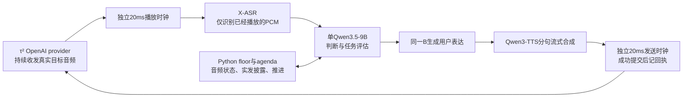

# τ² 本地用户模拟器接入：提交审阅与19场景实测

本次阶段验收关注三件事：19条受控样例是否确实在集成分支运行；本地推理是否会冻结被测语音服务；录音、输入披露和延迟是否有可复核证据。被测模型某项能力不合格，以及模拟用户措辞不自然，必须作为结果保留，不能靠场景推进状态变成“通过”。

## 代码位置与接入边界

原始 clone 位于 `/cpfs/user/jingpeng/workspace/tau2-voice-turn-taking`，保留上游 `main` 的 `0f634c66f9a90f573b6ca380229895fa992c391c`，工作区干净。开发位于独立 worktree `/cpfs/user/jingpeng/workspace/tau2-voice-local-user`，分支 `codex/local-user-simulator`。没有推送或创建PR。

正式试验导入的是本分支 `src/tau2/user/local/`，不是旧 `dynamic_pi` 的运行代码。复用旧环境中的模型服务、权重和已确认声音。每个样例的 `provenance.json` 记录实际导入路径、干净提交SHA、配置、提示词和场景哈希；`services.json` 保存实际服务模型与speaker信息。



- `LocalStreamingUser` 复用τ²的 `FullDuplexUser`、`UserMessage`、`AudioFormat` 和 registry；独立 `ContinuousVoiceDriver` 使用真实时钟，不调用原离散时间的暂停机制。
- 目标连接、会话配置、发送与截断复用现有 `OpenAIRealtimeProvider`。新增连续播放适配器不另开一套SDK连接。B选择INTERRUPT只启动用户语音；目标是否停止仍由目标服务端VAD决定。
- 原共享音频模块新增有状态原生PCM转换，用户16k、目标24k，避免走8k μ-law电话音频。录音与发送回执使用同一实际音频来源。
- 19样例、floor策略与确定性agenda迁入仓库；固定音频相同内容只存一份。没有同时维护一份旧库运行器作为正式测试入口。
- 当前入口是 `duplex_bench local` 的受控19场景实验；场景输入交付后推进采样，语义met另外留档，不能当作无限自由对话agenda的完成判定。它还不是直接替换所有 `tau2 run --domain ...` 的通用领域任务用户，也没有把这些结果伪装成τ²原有任务reward。

## 实际配置

| 组件 | 本次配置 |
|---|---|
| ASR | GilgameshWind/X-ASR-zh-en/160ms；sherpa-onnx 1.13.8；CPU、2线程 |
| 单B | Qwen/Qwen3.5-9B；同一服务负责判断和表达；关闭thinking |
| TTS | Qwen/Qwen3-TTS-12Hz-1.7B-Base；流式；emilia-zh-3；seed42；chunk tokens=2 |
| 声音校验 | reference SHA256 `7df4da8fc59d89e6f9a60f2b87218d02ff996d81d463a95e9d492d4a401889f8` |
| 目标 | gpt-realtime-1.5；marin；24k PCM；semantic VAD medium；interrupt_response=true |
| 观察边界 | 目标服务端文本仅审计；B只看实际播放音频的本地ASR |
| 发送边界 | client transport submit；不等于远端已听到，也不等于远端声卡播放 |

500ms是受控样例可判断窗口内的复查节奏，不是整个会话每500ms都请求B。下一阶段为overlap时，目标正在说话且已有至少1600ms播放、8字观察，才进入候选判断；普通handoff阶段主要等待交接，M01不会在目标每句话期间持续请求B。也不会在自己说话期间并发发请求。自己语音未结束、观察阶段、证据没有更新、场景触发条件未出现，都会有对应等待。正常交接时Python约束接话，不让 `met=false` 阻止回应；任务评估与开口权分开记录。本次迁移没有重新优化这些策略。

## 逐提交审阅

每次提交后审阅diff和阶段证据，再进入下一步；审阅结果也保存在 `git log --notes`。首轮全量从 `d598655` 运行，针对性补测从 `cc6b219` 运行。

| 提交 | 变更 | 提交后审阅 |
|---|---|---|
| `08dcfef` | 19场景、floor、agenda、素材与披露规则 | 7项测试；策略AST对齐；16素材身份去重为15份音频；P03仅已实发金额可披露 |
| `08d2d2c` | 独立用户内核、本地ASR/B/TTS、发送回执 | 14项测试；实际TTS→ASR闭环；首个有效PCM146.156ms；保留ASR误字 |
| `d18bf23` | τ²适配器、连续时钟、原生PCM、CLI | 18项测试；慢B/TTS各1.1s期间收发播放继续；真实P03 117.65s闭环 |
| `d598655` | 便携听测页与逐请求时延 | HTML脚本执行、外置媒体与链接检查；进入19条首轮 |
| `8fc0771` | 修复末尾ASR丢失、明确输出截断、可配置补测预算 | 20项测试；排空只发生于实时结束后且仅处理已播放音频，3s上限；旧缺尾部用本地partial显式标注 |
| `cc6b219` | R05开场补充Windows前提 | 7项场景/策略测试；噪声字节、增益、触发条件和其他18场景不变 |
| 最终报告提交（见Git记录） | 逐场景审阅注释、窄屏修正、初轮/补测导航、中文验收报告 | 注释绑定summary哈希；真实Chromium媒体/离线播放检查；报告测试与make check-all |

所有提交前均执行 `make check-all`，提交后 `git show --check`。audio-native变动要求的provider suite已经执行：77项因通用供应商凭据未配置而跳过，0失败，不能称为77项通过。另一次核心回归12通过、7项因缺通用OPENAI_API_KEY失败；这不替代使用专用Realtime key的真实测试。没有宣称全仓库测试全部通过。

## 首轮与补测必须分开读

首轮目录：`data/simulations/local-user-integration/20261125-all19-r1/`。19条均从干净集成提交运行，总计约46.39分钟。16条正常结束；I04和M01达到时间上限；R05未形成噪声刺激。另有3次目标输出触及2048 token上限（M01两次、P03一次）。`status=ok`本身不保证目标输出完整。

- I04：原180s截止时5个用户阶段均已发送，但目标告别被截止。补测给300s。
- R05：原目标先合理反问Windows还是Mac，没有进入操作步骤，因此噪声未发出。明确Windows后再测，不能把原无效刺激判成目标拒绝噪声失败。
- P03：首测一次问到两项金额，净转账57/96已说出，但长解释触发目标输出上限。补测输出上限4096。
- M01：原900s只走到15/16阶段，最终原始预算题未完整播放；目标文本包含正确答案也不能替代听到的证据。补测上限1800s、输出上限4096。

首轮原始结果没有覆盖。`final-review/attempts.json`保存所有尝试，`report-provenance.json`记录每个最终展示样例的来源。最终页选取最新完成尝试，不能作为同一次同版本实验的统一成功率统计。

## 指标口径与局限

- p50/p95是每项实际非空样本的线性分位数，给出样本数；未生成、取消或未发送不补0。B判断包含完整结构化输出，表达TTFT只到首token。P03的私有字段选择是额外B请求，原始请求表以field_selection单列，不应被当作零耗时。
- “决定→首音”从判断返回开始，不包含此前ASR、等待触发和B判断耗时。预录/模板样例必须与模型生成样例分开统计。
- 首音阈值为绝对采样幅度≥0.005，定位到20ms音频包；不是RMS、音素首字或远端听到时间。配置遗留字段虽叫 `effective_rms`，实现按绝对幅度判断。
- 表达请求总耗时可能包括下游TTS/发送队列背压，不可全部归为9B解码耗时。页面展示原始请求、输出、token和分段时间。
- M01测的是长目标会话及结构化用户状态。B使用最近6条交互加agenda，不能据此推断9B在数万token上下文中的性能上限；目标usage含音频/文本，与B输入token不是同一个量。
- 目标使用semantic VAD自动生成/截断响应，驱动不会在卡壳或重复编号时偷偷发response.create强迫目标插话。P01/P02/P04评价的是这套API配置的主动表现，不能外推成底层模型在其他触发架构下的能力。能忽略第三者的语义，也不代表音频可以不断；这两项必须分别评价。
- `ok`、agenda推进、B的 `met` 都不是独立语义评分。本轮只有每场景一次主试验和必要补测，不提供统计显著的模型排名。
- 已用真实Chromium验证19个场景的音频加载、播放推进和页面无脚本错误，同时核对媒体解码、传输和日志证据；主观音色、滋滋声及自然度仍交给人工听测，不以“无削波”代替“听感无噪声”。

## P03补测暴露的指标污染：不能怪目标漏问

补测 `20261126-rerun-short/P03` 中，目标第一轮已经同时询问饭钱和车费。实际播放的本地ASR把“饭钱”写成“范前”。B字段选择原始输出包含 `dinner_amount`，引文为“你需要告诉我范前总额”，并且也选中了 `taxi_amount`。但是Python的 `question_terms` 只有“饭/餐/吃/两笔/金额……”等锚点，不接受“范前总额”，发出 `scenario_private_field_rejected(reason=question_has_no_field_anchor)`，最终只披露车费。

所以目标第二轮只能追问饭钱，实际 `answer_rounds=2`。最终计算57/96正确。这是**本地ASR误字与确定性字段守卫组合造成的额外轮次**，不是本次B没理解，也不是目标漏问。初轮同一目标一次询问、一次披露成功，不应挑选较好结果覆盖补测。

本阶段保留迁移策略与此真实失败证据；P03的最终算账结果可以审阅，但本轮不能直接用自动披露轮次评价目标信息收集效率。正式模型比较前应单独修正字段守卫对有上下文依据的ASR同音错误的处理，并同时测试误披露风险；不能简单取消证据约束或偷偷把服务端全文送给模拟器。

首轮音频审计中，320/320次B判断期间仍有发送进展，逐段PCM与实发回执哈希一致，没有序号缺口或混音削波；这不代表操作系统时钟零抖动。首轮M01在857.319–857.705s有一次386.25ms发送间隔，同时播放时钟迟到367.12ms。当时正在发送用户第14轮音频，不能把它解释成等待B判断。日志不足以进一步区分进程调度、共享机器负载或其他短暂阻塞，因此保留为未定位的时钟抖动，精确听测请使用 `stereo-timing.flac`。

## 本地查看与复现

听测服务：`http://127.0.0.1:8796/`。该地址是运行实验机器的localhost；另一台电脑需把8796端口转发到本机。原8795服务保留。

页面位于 `data/simulations/local-user-integration/final-review/index.html`。音频按需加载，没有base64内嵌大录音；HTTP支持Range，拖动长录音不必先下载全文件。每个场景给出双声道、时间戳录音、原始日志、逐次B请求输入输出及组件时延。页面顶部可返回首轮19条，检查全部尝试和审阅MD；日志审阅注释绑定对应summary文件SHA256，避免复测后显示旧结论。已验证Chromium通过file路径直接打开离线HTML并播放音频。最终目录使用符号链接复用实际结果；拷贝离线版时需解引用这些链接，例如 `cp -rL final-review /目标路径/听测`，否则拷贝出的链接可能指向原服务器。

复现首轮：

```bash
uv sync --extra local-user --extra dev
# 启动对应的本地B/TTS服务；将Realtime凭据写入忽略的.env
.venv/bin/python -m experiments.tau_voice.duplex_bench local \
  --asr-model-path /path/to/x-asr-160ms \
  --output data/simulations/new-all19
```

复现补测：在上述命令增加 `--scenes I04,R05,P03 --max-seconds 300 --target-max-output-tokens 4096`；M01使用 `--scenes M01 --max-seconds 1800 --target-max-output-tokens 4096`。必须指定新目录，程序拒绝覆盖。

```bash
.venv/bin/python -m experiments.tau_voice.local_user_report \
  data/simulations/local-user-integration/final-review --serve --port 8796
```

声音、模型服务、ASR权重是外部运行依赖，不随代码复制；固定刺激音频与来源清单已经入库。ESC-50键盘音频保留CC BY-NC 3.0许可，不因仓库代码许可而改变。


## 最终展示数据与实测时延

最终页包含19条，录音合计52.01分钟，运行状态为 `{"ok": 19}`。这些是完成/运行状态，不是19项语义能力通过率。

| 指标 | n | p50 ms | p95 ms | 最大 ms |
|---|---:|---:|---:|---:|
| B完整判断 | 317 | 296.61 | 569.94 | 622.74 |
| P03私有字段选择（单列） | 2 | 442.98 | 514.93 | 522.93 |
| B表达首token | 69 | 35.03 | 49.79 | 52.44 |
| B首段可用文本 | 69 | 81.55 | 120.49 | 216.82 |
| TTS请求至首个有效PCM | 74 | 314.97 | 480.38 | 851.97 |
| 有效PCM至首音提交 | 74 | 10.11 | 20.18 | 80.32 |
| 仅B生成轮：决定完成至首音提交 | 69 | 410.8 | 574.51 | 927.31 |

上述B判断实际输入范围为416–1891 token。逐请求数据见 `final-review/review-metrics.json`；不能把各组件p50相加当成端到端p50。

最终选取的19条：317/317次B判断期间有发送进展；0项录音回执/格式/序列审计异常；目标输出incomplete共0次。最终所选录音的最大发送间隔48.95ms，没有混音削波。首轮独立保留，不能用最终选择掩盖原先的超时和输出截断。

## 19场景逐项日志审阅

| 场景 | 实际时长 | 运行状态 | 结论与听测重点 |
|---|---:|---|---|
| [I01](http://127.0.0.1:8796/#I01) | 100.91s | ok | 有效重叠打断；目标接到末班车追问并继续交通任务。未独立核验交通实时事实。 |
| [I02](http://127.0.0.1:8796/#I02) | 120.89s | ok | 有效重叠打断；否定A后目标转向B，未重启无关任务。 |
| [I03](http://127.0.0.1:8796/#I03) | 125.88s | ok | 打断和重说流程有效；模拟用户说出‘局部重说’，并把ASR片段解释成没声/没说完，自然度待改。 |
| [I04](http://127.0.0.1:8796/#I04) | 174.23s | ok | 补测174.23s、5/5阶段完整。目标从住宿切换到Windows打印机，再按用户要求回到住宿比较；最后告别录音与本地ASR均完整。 |
| [I05](http://127.0.0.1:8796/#I05) | 159.83s | ok | 有效重叠更正；目标后续明确使用12月12日出发、14日返回。 |
| [I06](http://127.0.0.1:8796/#I06) | 41.73s | ok | 有效重叠打断；要求一项选择/一个理由后，目标简短选择A并说明地铁噪音。 |
| [I07](http://127.0.0.1:8796/#I07) | 61.11s | ok | 喊停/4s观察/明确恢复均已执行；目标先确认停止。恢复后‘仅一件事’仍回答多个检查项，需听测。 |
| [I08](http://127.0.0.1:8796/#I08) | 133.85s | ok | 澄清刺激有效；目标以免赔额案例重讲。模拟用户又出现‘你说到一半就停了’的无根据措辞。 |
| [M01](http://127.0.0.1:8796/#M01) | 1093.25s | ok | 补测1093.25s（18分13秒），16/16阶段、16次目标回答均完整。实际听到：早期青竹47/不夜间自驾正确；当前三人、12月13–16日、机票住宿8500正确；原始两人合计6000正确。存在本地ASR误字，不等于目标说错。 |
| [P01](http://127.0.0.1:8796/#P01) | 37.09s | ok | 自然回撤卡壳音频有效，目标补出“备份”；首音在用户完整音频结束约2.57s后，不能证明卡壳中的实时补词。 |
| [P02](http://127.0.0.1:8796/#P02) | 98.34s | ok | 连续讲述刺激有效，目标在整段结束后回答，讲述期间无主动附和。 |
| [P03](http://127.0.0.1:8796/#P03) | 150.42s | ok | 补测150.42s完整，最终57/96正确且目标无输出截断。目标第一轮同时问了饭钱、车费；X-ASR将饭钱写成“范前”，B正确选中dinner_amount，但Python字段锚点将其拒绝，只实发车费，导致第二轮补问饭钱。answer_rounds=2受模拟器影响，不能归因目标少问一项。 |
| [P04](http://127.0.0.1:8796/#P04) | 87.50s | ok | 重复编号被正确识别，但直到用户六段录音全部说完后约2.33s才开口；距离重复小票片段结束约10.13s。没有证据表明按约定在持有话轮期间主动提醒。 |
| [R01](http://127.0.0.1:8796/#R01) | 128.08s | ok | 嗯声触发服务端VAD截断，目标重新组织原主题回答。音频未连续保持，因此不能判拒绝误打断成功。 |
| [R02](http://127.0.0.1:8796/#R02) | 99.25s | ok | 句中停顿未出现目标提前回答；完整条件后目标询问城市。模拟用户下一轮重复全部入住条件且未回答城市，连贯性不足。 |
| [R03](http://127.0.0.1:8796/#R03) | 106.84s | ok | 旁人说“小周，帮我把窗户关一下”后目标停下会议设备说明，转而回应关窗；有效旁人刺激，未实现忽略。 |
| [R04](http://127.0.0.1:8796/#R04) | 106.31s | ok | 同一用户转头说“小林，门口的快递帮我拿一下”被目标当成新任务；用户澄清后才回到出行话题，未忽略侧向说话。 |
| [R05](http://127.0.0.1:8796/#R05) | 166.63s | ok | 补测明确Windows后，约21.2s实际发送2s键盘噪声。原目标回答持续至约86.8s，没有播放截断或另起响应；本轮支持忽略该噪声。目标本身讲解很长，后续追问使总时长166.6s。 |
| [R06](http://127.0.0.1:8796/#R06) | 128.23s | ok | 同一第三者音频/相同增益在约定前后各播一次。约定前回应关窗；约定后不再处理关窗但仍停声并重启答复，语义改善不等于音频不断流。 |

## M01逐轮B输入与首音时延

本地B输入按实际请求usage统计；每行是一次已发送用户输入。目标回答的播放时长不属于B判断耗时。

| 轮次 / 阶段 | B判断输入token | 判断ms | 表达输入token | 表达TTFT ms | TTS首音ms | 决定→提交ms |
|---|---:|---:|---:|---:|---:|---:|
| 1 / opening | 466 | 175.50 | 419 | 33.58 | 851.97 | 927.31 |
| 2 / scope | 921 | 528.83 | 1072 | 42.58 | 177.02 | 286.86 |
| 3 / date_change | 997 | 411.07 | 982 | 38.66 | 253.10 | 386.87 |
| 4 / luggage | 1275 | 527.72 | 1364 | 49.52 | 271.62 | 390.22 |
| 5 / transfer | 1500 | 550.10 | 1314 | 49.59 | 460.43 | 568.58 |
| 6 / hotel | 1642 | 580.21 | 1335 | 49.93 | 503.32 | 578.46 |
| 7 / people_change | 1401 | 568.91 | 1147 | 43.91 | 263.06 | 348.51 |
| 8 / rest | 1382 | 478.28 | 1224 | 44.42 | 340.57 | 441.54 |
| 9 / budget_change | 1731 | 547.70 | 1339 | 50.11 | 307.99 | 408.12 |
| 10 / late_checkin | 1891 | 567.19 | 1499 | 52.44 | 293.41 | 427.22 |
| 11 / rain | 1538 | 579.55 | 1331 | 51.05 | 360.59 | 460.69 |
| 12 / packing | 1444 | 434.37 | 1241 | 45.37 | 254.27 | 344.55 |
| 13 / probe_early | 1264 | 479.55 | 505 | 30.38 | 300.88 | 458.15 |
| 14 / probe_current | 1014 | 311.32 | 511 | 32.46 | 123.41 | 346.92 |
| 15 / probe_original | 967 | 446.07 | 492 | 29.52 | 133.29 | 236.43 |
| 16 / close | 815 | 549.91 | 651 | 32.25 | 201.78 | 301.95 |

M01目标实际输入usage从283到5623 token，范围283–5941，包含音频和文本。B判断范围466–1891 token。本轮不能证明9B已经承受与目标相同的长上下文。

## 阶段判定

代码隔离、规范提交、连续音频接入、19场景真实运行和可追溯听测证据已完成。当前适合作为本地审阅版本；尚不能把它宣称为已校准完毕的自动评分基准。P03字段守卫的同音字误拒绝、I03/I08无依据的“没说完”、R02复述且未回答反问是模拟用户一侧明确需要关注的问题。目标端拒绝第三者、主动补词/附和/提醒等表现也按原样保留。

提交与本地听测关卡完成后停在本地，等待用户审阅。不会自动push或创建远端PR。
